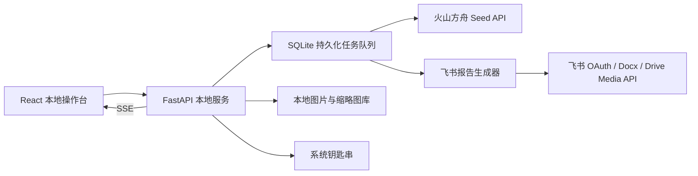

# Seed VLM 巡检系统设计规格

- 日期：2026-08-22
- 状态：已获用户批准
- 产品形态：个人本机 Web 应用
- 技术路线：React + FastAPI + SQLite

## 1. 背景

现有飞书表格维护了三类图片巡检提示词：通用员工仪容仪表、店总仪容仪表、厨师着装与个人卫生。当前流程缺少统一的模型连接配置、批量任务管理、结构化结果校验、失败恢复和飞书报告归档。

本系统在个人电脑上运行，通过火山方舟 Seed 系列多模态模型逐张检查图片，并将一个批量任务汇总成一篇带图片的飞书文档。

## 2. 已确认需求

1. 系统只供单个用户在本机使用，不建设账号、租户或公网服务。
2. 前端可配置火山方舟 API Base URL、模型 ID 或 Endpoint ID、API Key 和调用参数。
3. 系统支持保存多个巡检提示词模板，任务开始后保存模板与模型配置快照。
4. 每张图片独立调用模型、独立产生结果；单任务首版支持 1–100 张图片。
5. 前端同时提供批量缩略图和单张大图详情。
6. 模型返回固定结构：合格、不合格或无法判断，并包含问题项、视觉证据和置信度。
7. 批量任务全部成功时自动创建一篇新的飞书文档。
8. 飞书文档包含图片缩略图、任务统计和逐图结果。
9. 飞书使用用户 OAuth，文档归属当前用户。
10. 如果存在最终失败项，系统停在复核状态；用户可以重试，或明确选择带失败项生成报告。

## 3. 目标与非目标

### 3.1 目标

- 让非开发用户在浏览器中完成连接配置、模板维护、图片导入、批量运行、单图复核和飞书归档。
- 保证一张图片与一份结果稳定绑定，应用重启后仍可恢复任务。
- 用固定 JSON Schema 消除自由文本解析的不确定性。
- 让报告中的每项结论都能回到原图和可见证据。
- API Key、飞书 App Secret 和 OAuth 令牌不进入浏览器持久化、SQLite 或普通日志。

### 3.2 首版非目标

- 多用户登录、团队权限、租户隔离或公网部署。
- 一组多张图片合并成一个模型判断。
- 视频巡检、实时摄像头或移动端原生应用。
- 自定义结果 JSON Schema。
- 从飞书表格自动同步提示词；首版将现有三类提示词人工整理为内置初始模板。
- 人工直接修改模型结论；首版通过调整模板或单图重跑进行修正。
- 分布式队列、Redis、Celery 或独立任务集群。

## 4. 技术方案

### 4.1 选型

- 前端：React、TypeScript、Vite、React Router、TanStack Query。
- 后端：Python、FastAPI、Pydantic、SQLAlchemy 2、Alembic。
- 数据库：SQLite，启用 WAL 模式。
- 模型客户端：火山方舟官方 Python SDK；保留 Responses API 与 Chat Completions 两个适配器。
- 飞书客户端：`httpx` 调用飞书 OpenAPI。
- 图片处理：Pillow；首版接受 JPEG、PNG、WebP。
- 密钥存储：系统钥匙串，通过 Python `keyring` 访问。
- 实时进度：Server-Sent Events（SSE）。
- 后台任务：FastAPI 单进程内的数据库持久化异步队列。

选择本地 Web 应用而非 Streamlit，是为了获得稳定的任务队列、可恢复状态和更完整的图片工作台；不选择 Tauri，是为了控制首版打包和跨语言复杂度。

### 4.2 运行拓扑



服务只监听 `127.0.0.1`。生产运行使用单个 Uvicorn worker，避免多个进程重复消费同一任务。

### 4.3 本地数据目录

运行数据放在用户目录下的专用应用目录，不写入源码仓库：

```text
~/.vlm-inspector/
├── app.db
├── images/<task-id>/original/
├── images/<task-id>/inference/
├── images/<task-id>/thumbs/
└── logs/app.log
```

- `original` 保存导入副本，确保原路径移动后任务仍可复现。
- `inference` 保存纠正 EXIF 方向并缩放后的模型输入图。
- `thumbs` 保存界面和飞书报告使用的缩略图。
- 删除本地任务时删除对应图片与结果，但不删除已经生成的飞书文档。

## 5. 产品界面

### 5.1 导航

左侧固定导航包含四个入口：

1. 运行任务
2. 提示词模板
3. 历史记录
4. 设置

### 5.2 持续工作台

任务页面采用已批准的持续工作台布局：

- 顶部：任务名、模板、总体进度、开始、暂停、继续和报告状态。
- 左侧：图片缩略图网格，显示待处理、运行中、合格、不合格、无法判断、失败六种状态。
- 右侧：当前图片大图、总体结论、问题项、视觉证据、置信度、未检查项和单图重跑按钮。
- 筛选：全部、异常、无法判断、失败。
- 任务完成后显示飞书文档链接。

### 5.3 设置页

火山方舟配置：

- API Base URL，默认 `https://ark.cn-beijing.volces.com/api/v3`。
- API 协议：Responses（默认）或 Chat Completions。
- 模型 ID / Endpoint ID，接受模型 ID 或以 `ep-` 开头的 Endpoint ID。
- API Key。
- 并发数，默认 3，允许 1–5。
- 单图超时，默认 120 秒。
- 自动重试次数，默认 2。
- 深度思考：关闭、自动或开启；巡检模板默认关闭以降低延迟和成本。
- “测试并保存”使用一张内置小图验证鉴权、图片输入和结构化返回，而不只测试文本调用。

飞书配置：

- 自建应用 App ID。
- App Secret。
- 固定本机回调地址 `http://127.0.0.1:8000/api/auth/feishu/callback`。
- 浏览器 OAuth v3 授权，使用 PKCE S256、一次性 state、授权状态和重新授权。
- 可选的默认报告文件夹链接或 token；留空时写入用户根目录。
- 设置页提供在飞书开放平台配置回调地址及最小权限的操作说明。权限能力限定为：创建及编辑 Docx、在选定目录创建文档、上传 Docx 图片素材。

保存后的密钥字段只返回“已配置”状态，不返回原始值。
如果系统钥匙串不可用，保存凭据操作直接失败并给出修复说明；首版不提供明文文件或 SQLite 降级存储。

## 6. 提示词模板

### 6.1 模板字段

- 名称
- 描述
- 适用对象
- 检查规则列表，每条含稳定 `rule_id`、规则名称和规则文本
- 任务补充说明
- 模型参数：temperature、最大输出 token、深度思考模式
- 版本号、创建时间和更新时间

首版内置模板：

1. 通用员工仪容仪表
2. 店总仪容仪表
3. 厨师着装与个人卫生

整理现有提示词时必须删除或改写仅凭照片无法可靠判断的要求，例如气味、日常清洁习惯和未呈现在画面中的行为。系统级提示词始终包含以下不可覆盖规则：

- 只判断图片中清晰可见的事实。
- 不根据身份、性别、职业或环境推测不可见事实。
- 遮挡、未入镜或分辨率不足使用 `not_visible`。
- 每个 `fail` 必须给出可在图片中复核的位置和视觉观察。
- 不把“未看见”自动解释为“违规”，除非规则本身要求某物必须在可见位置出现，例如工牌。

### 6.2 版本与任务快照

模板每次修改创建新版本。任务创建时保存以下不可变快照：

- 模板版本与完整提示词
- 规则列表
- API 协议
- 模型 ID / Endpoint ID
- 模型参数

因此后续修改模板或设置不会改变历史任务的语义。

### 6.3 单图测试

模板保存前可以选择一张图片执行测试。测试结果经过与正式任务相同的 Schema 校验，但不进入任务历史、不生成飞书报告。

## 7. 模型输入与输出

### 7.1 图片预处理

1. 校验 MIME 类型和文件可读性。
2. 纠正 EXIF 方向。
3. 保留原始文件副本。
4. 生成适合推理的 RGB 图片；默认最长边不超过 2048 像素，不放大小图。
5. 生成报告缩略图；最长边不超过 1600 像素，并控制在飞书素材上传限制内。
6. 同一任务内以 SHA-256 识别完全相同的文件；重复文件在开始前列出并跳过，不跨任务复用模型结果。

### 7.2 方舟请求

默认使用 Responses API。请求由三部分组成：

1. 系统证据规则。
2. 当前模板的检查规则和输出语义。
3. 单张图片的本地 Base64 数据 URL。

如果所选模型/Endpoint 不支持 Responses API，用户在设置中显式切换到 Chat Completions；系统不在正式任务中静默切换协议。

模型原生支持 JSON Schema 时使用原生结构化输出；不支持时使用严格 JSON 提示并由 Pydantic 校验。解析或 Schema 校验失败后允许一次格式修复请求，修复仍失败则该图片进入失败状态。

### 7.3 固定结果 Schema

```json
{
  "schema_version": 1,
  "image_valid": true,
  "unverifiable_reason": null,
  "verdict": "fail",
  "summary": "工牌缺失，右袖口有明显污渍",
  "overall_confidence": 0.92,
  "findings": [
    {
      "rule_id": "badge",
      "rule_name": "工牌佩戴",
      "status": "fail",
      "observation": "左胸未见工牌",
      "visual_evidence": "左胸区域无遮挡，未出现工牌",
      "confidence": 0.92
    },
    {
      "rule_id": "nails",
      "rule_name": "指甲规范",
      "status": "not_visible",
      "observation": "手部未入镜",
      "visual_evidence": "画面不包含手部",
      "confidence": 1.0
    }
  ]
}
```

枚举：

- `verdict`：`pass`、`fail`、`unverifiable`
- `finding.status`：`pass`、`fail`、`not_visible`
- `confidence`：0 到 1

总体结论规则：

- 任一可见规则为 `fail`，总体为 `fail`。
- 图片无效，或没有任何适用规则可被可靠观察，总体为 `unverifiable`。
- 至少一个适用规则可见，所有可见规则均通过，总体为 `pass`；未入镜规则仍在 `findings` 中标记为 `not_visible`。

后端根据 findings 重新计算总体结论并与模型值核对；不一致时以确定性规则为准，并记录校正事件。

## 8. 任务状态与数据流

### 8.1 任务状态

任务状态：

```text
DRAFT → QUEUED → RUNNING ↔ PAUSED
                     ├→ REVIEW_REQUIRED
                     ├→ EXPORTING → COMPLETED
                     └→ CANCELED
```

图片状态：

```text
QUEUED → RUNNING → SUCCEEDED
                 ├→ FAILED
                 └→ CANCELED
```

应用启动时，将遗留的 `RUNNING` 图片恢复为 `QUEUED`，并将对应任务恢复为 `PAUSED`，由用户明确继续，避免启动即产生外部调用。

### 8.2 主流程

1. 用户选择模板并创建任务。
2. 导入 1–100 张图片，系统复制文件、预处理、去重并生成缩略图。
3. 用户开始任务；后端以默认 3 路并发逐图调用 Seed。
4. SSE 推送状态和结果；SQLite 是真实状态源，断线后前端重新查询即可恢复。
5. 每个成功结果经过 Schema 和确定性结论校验后入库。
6. 全部图片成功时进入 `EXPORTING`，自动创建飞书文档。
7. 存在最终失败图片时进入 `REVIEW_REQUIRED`。用户可重试失败项，或确认带失败项生成报告。
8. 报告完成后保存 `document_id` 和 URL，任务进入 `COMPLETED`。

暂停只阻止领取新图片；已经发出的请求允许结束并保存结果。取消将待处理图片改为 `CANCELED`，不会删除已经产生的结果。

## 9. 飞书报告

### 9.1 文档结构

标题格式：`{任务名} 巡检报告 {YYYY-MM-DD HH:mm}`。

正文顺序：

1. AI 生成声明：“AI 生成结果，仅供人工复核；系统只判断图片中清晰可见的内容。”
2. 任务信息：模板名称与版本、模型或 Endpoint、图片数量、开始和完成时间。
3. 汇总统计：合格、不合格、无法判断、执行失败。
4. 问题汇总：按规则统计失败数量和主要观察。
5. 图片明细：报告缩略图、文件名、总体结论、总体置信度、摘要、逐项结果、视觉证据和未检查项。
6. 执行失败清单及可读错误原因。
7. 追溯信息：任务 ID、模板快照哈希、模型参数和 Schema 版本。

### 9.2 生成策略

- 先创建文档并立刻保存 `document_id`，再写正文，保证中断后可续写。
- 文档块按飞书单次请求限制分批写入，并将编辑调用控制在每秒 3 次以内。
- 每张图片先创建对应的 Docx 图片块并保存 `block_id`，再以该块作为 `docx_image` 上传点写入素材。
- 图片素材串行上传，遵守飞书素材接口“不并发、最多 5 QPS”的限制。
- 每成功写入一段就保存游标；重试从游标继续，不新建第二篇文档。
- OAuth access token 过期时先使用 refresh token 刷新；刷新失败才要求重新授权。
- 报告生成失败不重新调用模型。
- 用户主动再次生成时创建新版本报告，并在任务中记录所有报告 URL；自动重试只续写原文档。

## 10. 数据模型

### 10.1 SQLite 表

- `app_settings`：非敏感设置和钥匙串引用。
- `prompt_templates`：模板身份、当前版本和启用状态。
- `prompt_template_versions`：不可变模板正文、规则和模型参数。
- `tasks`：任务状态、模板快照、模型快照、计数和时间。
- `task_images`：图片路径、哈希、顺序、状态、尝试次数和错误分类。
- `inference_results`：原始响应的脱敏副本、规范化 JSON、Schema 版本和校正记录。
- `inference_attempts`：每次调用的开始时间、耗时、状态码、错误分类和 token 用量；不保存密钥。
- `report_exports`：飞书文档 ID、URL、状态、写入游标和错误。

### 10.2 关键约束

- `task_images` 通过不可变主键与结果关联，不使用文件名关联。
- 每个图片最多有一个当前有效结果；重跑保留历史 attempt，但替换当前结果引用。
- 自动报告对每个任务有唯一活动 export，防止并发创建重复文档。
- 删除模板不物理删除历史版本；已被任务引用的版本永久保留。

## 11. 本地 API 边界

前端只通过同源 `/api` 调用后端。主要资源：

- `/api/settings/ark`：读取脱敏状态、保存与测试方舟配置。
- `/api/settings/feishu`：读取脱敏状态、保存应用配置。
- `/api/auth/feishu/start|callback|status`：OAuth 流程。
- `/api/templates`、`/api/templates/{id}/versions`、`/api/templates/{id}/test`：模板管理与单图测试。
- `/api/tasks`：创建、查询、开始、暂停、继续、取消。
- `/api/tasks/{id}/images`：导入与列出图片。
- `/api/tasks/{id}/images/{image_id}/retry`：单图重跑。
- `/api/tasks/{id}/events`：SSE 进度。
- `/api/tasks/{id}/report`：手动生成或查询报告。

所有写接口使用 Pydantic 请求模型。上传接口限制文件数量、单文件大小和 MIME 类型，并对文件名进行净化；服务端不接受任意绝对路径作为 API 参数。

## 12. 安全与隐私

- API Key、App Secret、access token 和 refresh token只存入系统钥匙串。
- 浏览器不使用 `localStorage`、`sessionStorage` 或 IndexedDB 保存密钥。
- 后端读取密钥后只返回布尔状态和掩码，不返回原文。
- 系统钥匙串不可用时拒绝持久化凭据，不降级保存明文。
- 日志过滤 `Authorization`、API Key、OAuth code、令牌和图片 Base64。
- CORS 只允许自身页面；服务只绑定 `127.0.0.1`。
- OAuth 使用随机 `state`，验证回调并防止重放。
- OAuth token 交换使用当前的 v3 端点 `https://accounts.feishu.cn/oauth/v3/token`，不使用已标记为历史版本的 v2 端点。
- 所有模型输入图片会发送至用户配置的火山方舟服务；生成报告时缩略图会发送至飞书。界面在首次运行前明确提示这两个数据流。
- 任务删除提供明确确认，并只删除本地副本；飞书文档需由用户在飞书中管理。

## 13. 错误处理

| 场景 | 行为 |
| --- | --- |
| 图片损坏、空文件或格式不支持 | 导入阶段拒绝，显示文件名和原因，不创建队列项 |
| 方舟 401/403 | 暂停整个任务，标记配置错误，不自动重试 |
| 方舟 429 | 优先遵循 `Retry-After`，否则指数退避并加入抖动 |
| 方舟超时或 5xx | 指数退避，最多自动重试 2 次 |
| 方舟 4xx 参数错误 | 标为不可重试，暂停任务并提示检查协议、模型或 Endpoint |
| JSON/Schema 不合规 | 允许一次格式修复请求；仍失败则图片失败 |
| 用户暂停 | 不领取新图片，保存正在执行的结果 |
| 应用异常退出 | 下次启动把运行中图片恢复为排队，任务保持暂停 |
| 飞书 access token 过期 | 自动刷新后重试当前步骤 |
| 飞书 429/频控 | 按响应与指数退避重试，不并发上传素材 |
| 飞书权限或目录无权访问 | 报告失败并要求重新授权或更换目录；模型结果保留 |
| 飞书写入中断 | 使用已保存文档 ID 和游标续写，避免重复文档 |

错误在数据库中保存稳定的 `error_code` 和用户可读消息；第三方原始响应只保存脱敏摘要。

## 14. 测试策略

### 14.1 单元测试

- 提示词组装与系统规则不可覆盖。
- Pydantic Schema 解析、枚举、置信度范围和结论重算。
- 图片类型、EXIF 方向、缩略图与哈希去重。
- 重试分类、退避计算和最大次数。
- 任务状态机和应用重启恢复。
- 飞书汇总统计、文档块生成和写入游标。
- 日志脱敏与密钥不落库。

### 14.2 集成与契约测试

- 使用 MockTransport 模拟 Responses API、Chat Completions 和飞书 OpenAPI。
- 覆盖 401、403、429、5xx、超时、无效 JSON、令牌刷新和部分文档写入。
- SQLite 迁移、WAL、队列领取和幂等约束。
- OAuth state 校验、回调与 refresh token 更新。
- 使用固定样例图片验证图片与结果映射不串位。

### 14.3 前端与端到端测试

- 组件测试：设置表单、模板编辑器、缩略图状态、单图详情和错误提示。
- Playwright 端到端：配置模拟服务、创建模板、导入图片、运行、暂停、恢复、单图重跑和报告完成。
- 浏览器测试验证 API Key 不出现在存储、页面源代码或网络响应中。

真实外部服务测试作为手动 smoke test，只使用用户本机凭据，不在 CI 中保存真实密钥。

## 15. 验收标准

1. 用户可以在前端保存并测试一个火山方舟模型 ID 或 Endpoint ID。
2. 用户可以完成飞书 OAuth，并看到当前授权状态。
3. 用户可以创建、编辑和测试多个版本化提示词模板。
4. 单张图片运行后可在同一页面查看大图和结构化结果。
5. 100 张图片以配置并发执行，图片 ID 与结果始终一一对应。
6. 任务暂停后不再领取新图片；应用重启后可恢复并继续。
7. 方舟限流、超时和无效 JSON 按设计重试；鉴权错误不会反复调用。
8. 全部成功时自动生成一篇飞书文档；存在失败项时进入复核状态。
9. 飞书报告统计与数据库逐图结果一致，且每张图片对应正确缩略图。
10. 报告中断后重试不会创建重复文档或重复正文段落。
11. API Key、App Secret 和 OAuth 令牌不出现在浏览器持久化、SQLite、普通日志或错误消息中。

## 16. 官方接口依据

- [火山方舟图片理解](https://www.volcengine.com/docs/82379/1362931?lang=zh)
- [火山方舟 Responses API 使用指南](https://www.volcengine.com/docs/82379/1585128?lang=zh)
- [火山方舟 OpenAI SDK 兼容说明](https://www.volcengine.com/docs/82379/1330626?lang=zh)
- [火山方舟模型列表](https://www.volcengine.com/docs/82379/1554682)
- [飞书创建 Docx](https://open.feishu.cn/document/server-docs/docs/docs/docx-v1/document/create?lang=zh-CN)
- [飞书获取 user_access_token（最新 OAuth）](https://open.feishu.cn/document/authentication-management/access-token/get-user-access-token?lang=zh-CN)
- [飞书 Docx 接入指南与块写入](https://open.feishu.cn/document/server-docs/docs/docs/docx-v1/guide?lang=zh-CN)
- [飞书上传云文档素材](https://open.feishu.cn/document/server-docs/docs/drive-v1/media/upload_all?lang=zh-CN)
- [飞书素材能力与频控](https://open.feishu.cn/document/server-docs/docs/drive-v1/media/introduction?lang=zh-CN)
